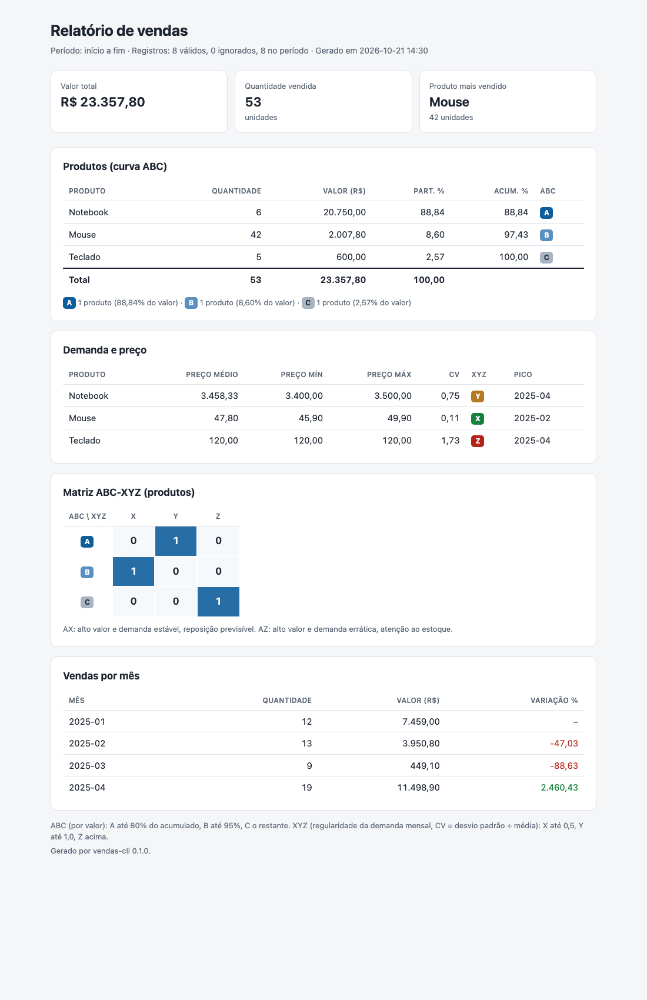

# vendas-cli

[](https://github.com/zaiinehaniel/vendas-cli/actions/workflows/ci.yml)

CLI em Python que lê um CSV de vendas e gera um relatório em texto, JSON ou HTML.

Além do que o desafio pede (total por produto, valor geral e produto mais vendido), o relatório traz análises usadas em gestão de vendas e estoque:

- **Curva ABC**: quais produtos concentram o valor vendido.
- **Classificação XYZ**: quão regular é a demanda mensal de cada produto.
- **Matriz ABC-XYZ**: cruza as duas classificações.
- **Preço praticado**: preço médio ponderado, mínimo e máximo por produto.
- **Sazonalidade**: vendas mês a mês, variação sobre o mês anterior e mês de pico de cada produto.

Só usa a biblioteca padrão, sem dependências de runtime. Requer Python 3.10 ou superior; o CI testa do 3.10 ao 3.13.

## Instalação

```bash
git clone https://github.com/zaiinehaniel/vendas-cli.git
cd vendas-cli
python -m venv .venv
source .venv/bin/activate        # Windows: .venv\Scripts\activate
pip install .
```

Para desenvolver (testes, mypy e ruff):

```bash
pip install -e ".[dev]"
```

## Uso

```bash
vendas-cli vendas.csv --format text
vendas-cli vendas.csv --format json --start 2025-01-01 --end 2025-03-31
vendas-cli vendas.csv --format html -o relatorio.html
```

Também funciona como `python -m vendas_cli`. Para testar, há um CSV em `exemplos/vendas.csv`.

| Opção | Padrão | Descrição |
|---|---|---|
| `arquivo` | obrigatório | CSV de vendas |
| `--format {text,json,html}` | `text` | Formato do relatório |
| `-o`, `--output SAIDA` | terminal | Grava o relatório em arquivo (UTF-8) |
| `--start AAAA-MM-DD` | sem limite | Considera vendas a partir desta data, inclusive |
| `--end AAAA-MM-DD` | sem limite | Considera vendas até esta data, inclusive |
| `-v`, `--verbose` | | Mostra mensagens informativas e de depuração |
| `-q`, `--quiet` | | Mostra só erros |
| `--version` | | Mostra a versão |

O relatório vai para a saída padrão e as mensagens de log vão para a saída de erro. Assim o JSON pode ser encadeado direto, por exemplo `vendas-cli vendas.csv --format json | jq .valor_total`.

**Códigos de saída:** `0` relatório gerado · `1` erro ao ler o CSV ou gravar a saída · `2` argumento inválido.

## Formato do CSV

```csv
data,produto,quantidade,preco_unitario
2025-01-10,Notebook,2,3500.00
2025-01-15,Mouse,10,45.90
2025-02-20,Notebook,1,"3.400,00"
```

- Cabeçalho obrigatório com as quatro colunas, em qualquer ordem. Colunas extras são ignoradas.
- Arquivo em UTF-8 (com ou sem BOM).
- `data` no formato `AAAA-MM-DD`.
- `quantidade` inteira e maior que zero.
- `preco_unitario` maior ou igual a zero, com ponto (`45.90`) ou no formato brasileiro entre aspas (`"45,90"`, `"1.234,56"`). Sem aspas, a vírgula separaria colunas.

Uma linha inválida não interrompe o processamento. Ela é ignorada e gera um aviso com o número da linha e o motivo:

```
AVISO: linha 5 ignorada: quantidade deve ser maior que zero: 0
```

Arquivo inexistente, vazio, fora de UTF-8 ou sem coluna obrigatória encerra com erro (código 1).

## Exemplo de saída

`vendas-cli exemplos/vendas.csv`:

```
Relatório de vendas
Período: início a fim
Registros: 8 válidos, 0 ignorados, 8 no período

Produtos (curva ABC)
Produto   Quantidade  Valor (R$)  Part. %  Acum. %  ABC
--------  ----------  ----------  -------  -------  ---
Notebook           6   20.750,00    88,84    88,84  A
Mouse             42    2.007,80     8,60    97,43  B
Teclado            5      600,00     2,57   100,00  C
--------  ----------  ----------  -------  -------  ---
TOTAL             53   23.357,80   100,00

Produto mais vendido: Mouse (42 unidades)

Curva ABC: A 1 produto (88,84%) · B 1 produto (8,60%) · C 1 produto (2,57%)

Demanda e preço
Produto   Preço médio  Preço mín  Preço máx    CV  XYZ  Pico
--------  -----------  ---------  ---------  ----  ---  -------
Notebook     3.458,33   3.400,00   3.500,00  0,75  Y    2025-04
Mouse           47,80      45,90      49,90  0,11  X    2025-02
Teclado        120,00     120,00     120,00  1,73  Z    2025-04

Matriz ABC-XYZ (produtos)
ABC  X  Y  Z
---  -  -  -
A    0  1  0
B    1  0  0
C    0  0  1

Vendas por mês
Mês      Quantidade  Valor (R$)  Variação %
-------  ----------  ----------  ----------
2025-01          12    7.459,00           -
2025-02          13    3.950,80      -47,03
2025-03           9      449,10      -88,63
2025-04          19   11.498,90    2.460,43
```

O JSON traz os mesmos dados, com valores monetários e percentuais como string (`"20750.00"`) para não perder precisão. A estrutura completa está na seção 4 do [SPEC.md](SPEC.md).

O HTML (`--format html -o relatorio.html`) é um arquivo único, sem JavaScript e sem nada carregado da internet. Abre offline e pode ser salvo em PDF pelo navegador.



## Como ler o relatório

**Curva ABC (por valor).** Os produtos são ordenados por valor vendido e acumulados:

- **A**: os que formam os primeiros 80% do valor.
- **B**: até 95%.
- **C**: o restante.

O produto que cruza a marca de 80% ainda entra como A. Poucos produtos A costumam responder pela maior parte do faturamento.

**Classificação XYZ (regularidade da demanda).** Usa o coeficiente de variação (desvio padrão ÷ média) da quantidade vendida por mês. Os meses em que o produto não vendeu contam como zero.

- **X**: CV até 0,5, demanda estável.
- **Y**: CV até 1,0, demanda variável.
- **Z**: CV acima de 1,0, demanda errática.

Com menos de 3 meses no período, a XYZ não é calculada.

**Matriz ABC-XYZ.** Cruza as duas classificações:

- **AX**: alto valor e demanda previsível. Bom candidato a reposição automática.
- **AZ**: alto valor e demanda errática. Pede atenção no estoque.
- **CZ**: pouco valor e demanda errática. Candidato a revisão do mix.

**Vendas por mês.** Meses sem venda entre o primeiro e o último mês aparecem zerados, porque a lacuna também é informação de sazonalidade. A variação compara o valor com o mês anterior e fica vazia no primeiro mês e depois de um mês zerado.

## Desenvolvimento

```bash
pytest                 # testes + cobertura (mínimo 80%, configurado no pyproject.toml)
mypy                   # tipagem estrita em src/
ruff check src tests   # lint
ruff format src tests  # formatação
```

```
src/vendas_cli/
├── models.py          # dataclasses imutáveis: Venda, ResumoProduto, Relatorio...
├── normalizer.py      # texto -> data, quantidade, preço (inclui formato pt-BR)
├── parser.py          # leitura do CSV e validação linha a linha
├── core.py            # filtro, totais, ABC, XYZ, preço, pico e vendas por mês
├── formatacao.py      # números, períodos e plurais em pt-BR
├── output.py          # saída em texto e JSON
├── relatorio_html.py  # saída em HTML
└── cli.py             # argparse, logging e códigos de saída
```

`core`, `output` e `relatorio_html` são funções puras, sem I/O. Ler e gravar arquivos, configurar o logging e definir o código de saída fica só com o `parser` e o `cli`.

## Decisões

A especificação completa, com os motivos de cada escolha, está no [SPEC.md](SPEC.md). Em resumo:

- **Dinheiro em `Decimal`**, nunca `float`, com arredondamento a 2 casas (`ROUND_HALF_UP`) só na saída.
- **Produto mais vendido** é o de maior quantidade. No empate vale o maior valor e, persistindo, a ordem alfabética.
- **Filtro de data** inclusivo nas duas pontas. Dá para usar só `--start` ou só `--end`.
- **Período sem vendas** gera relatório zerado (código 0), não erro.
- **Sem pandas.** O enunciado pede leitura com a biblioteca padrão e o volume esperado não justifica a dependência. Para bases grandes, pandas seria a escolha natural.
- **HTML em vez de PDF**, porque não exige dependência e o navegador já exporta para PDF.
